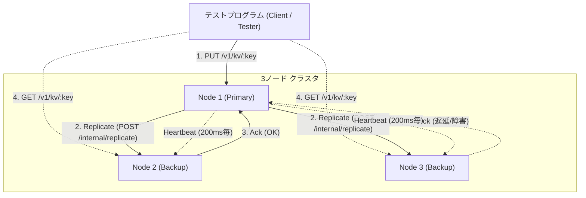
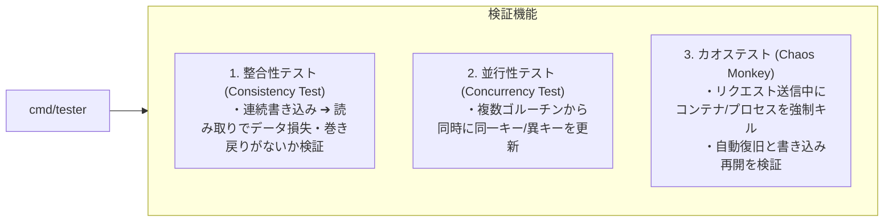

# 分散キーバリューストア（Primary-Backup型） 詳細設計書

## 1. システム概要と設計方針

本システムは、Go言語を用いて分散システムの基本概念（ノード間通信、状態レプリケーション、過半数合意、障害検知、フェイルオーバー）を体感・習得するためのコンパクトな分散キーバリューストア（KVS）です。

### 1.1 基本設計方針
- **依存の最小化**: Go標準ライブラリ（`net/http`, `sync`, `context` 等）を中心に構成。外部DBや巨大フレームワークに依存せず、分散ロジックの本質をコードで直接記述します。
- **デバッグ容易性**: ノード間通信およびクライアント通信には **HTTP/JSON** を採用します。`curl` やログ出力を直接目視でき、トラブルシューティングを容易にします。
- **再現性・テスト容易性**: ローカル単一ホスト（ポート別複数プロセス）、Podmanコンテナ、kind（Kubernetes）のいずれでも全く同じバイナリが動作する構成とします。

---

## 2. 全体アーキテクチャ

クラスタは原則として **3ノード構成**（Node 1, Node 2, Node 3）を基本とします。



### 2.1 ノードのロールと状態遷移
各ノードは以下のいずれかの状態（Role）を持ちます。

- **`Primary`**:
  - クライアントからの書き込み（`PUT`）を処理する唯一のノード。
  - Backupへログ/更新を複製（Replication）し、過半数の応答を確認してクライアントに完了を返す。
  - 定期的にBackupへハートビートを送信してリーダー権を維持する。
- **`Backup`**:
  - Primaryからの複製リクエストを受信してローカルデータを更新する。
  - クライアントからの読み取り（`GET`）を受け付ける。
  - Primaryからのハートビートを監視し、一定時間途絶えたら `Candidate` へ遷移する。
- **`Candidate`**:
  - Primary不在を検知し、自らを次期Primaryとして他ノードへ投票を要請（RequestVote）する一時状態。
  - 過半数の賛成を獲得すると `Primary` へ昇格。他者が先にPrimaryになったら `Backup` に戻る。

---

## 3. データモデルとストレージ構造

各ノードはインメモリのハッシュマップでデータを保持します。

### 3.1 データ構造
```go
type Item struct {
    Key       string    `json:"key"`
    Value     string    `json:"value"`
    Version   int64     `json:"version"`   // 単調増加する論理バージョン
    UpdatedAt time.Time `json:"updated_at"`
}

type MemoryStore struct {
    mu    sync.RWMutex
    items map[string]Item
}
```

- **Version（論理タイムスタンプ）**:
  - Primaryがキーを更新するたびにインクリメントします。
  - Backupノードは、受信した更新の `Version` が自身の持つバージョンより新しい場合のみ上書き適用することで、順序逆転による古いデータの混入を防ぎます。

---

## 4. 通信API仕様

### 4.1 クライアント向けAPI（外部公開）

| メソッド | パス | 説明 | 備考 |
| :--- | :--- | :--- | :--- |
| `PUT` | `/v1/kv/{key}` | データの登録・更新 | Primaryのみ受付。Backupが受けた場合は `307 Temporary Redirect` または Primaryのアドレスを返す |
| `GET` | `/v1/kv/{key}` | データの取得 | 全ノード（Primary/Backup）で受付可能 |
| `GET` | `/v1/cluster/status` | ノード自身の状態取得 | 現在のRole、Term（世代）、保持キー数、クラスタ構成などを返却 |

#### リクエスト / レスポンス例
- **`PUT /v1/kv/user:100`**
  ```json
  // Request Body
  { "value": "Alice" }

  // Response (200 OK)
  { "key": "user:100", "value": "Alice", "version": 1 }
  ```
- **`GET /v1/cluster/status`**
  ```json
  // Response (200 OK)
  {
    "node_id": "node-1",
    "role": "Primary",
    "term": 1,
    "peers": ["node-2:8002", "node-3:8003"],
    "key_count": 42
  }
  ```

---

### 4.2 ノード間通信API（内部同期）

| メソッド | パス | 送信元 ➔ 送信先 | 説明 |
| :--- | :--- | :--- | :--- |
| `POST` | `/internal/replicate` | Primary ➔ Backup | 更新データのレプリケーション要求 |
| `POST` | `/internal/heartbeat` | Primary ➔ Backup | 生存確認およびリーダー維持のリース通知 |
| `POST` | `/internal/request-vote`| Candidate ➔ Backup/Primary | フェイルオーバー時の投票要請 |

---

## 5. レプリケーションと障害耐性のメカニズム

### 5.1 過半数（Quorum: クォーラム）書き込み
3台構成（$N=3$）において、書き込みの成功条件を**過半数（2台以上）の確定**とします。

1. クライアントが Primary に `PUT /v1/kv/foo` を送信。
2. Primary はローカルのメモリに書き込む（これで 1/3 台確定）。
3. Primary は並行して全Backup（Node 2, Node 3）に `/internal/replicate` を送信。
4. **どちらか1台のBackupから成功Ackが返った時点で、合計2台（過半数）達成**。
5. Primary は即座にクライアントへ HTTP 200 を返す（もう1台の遅延ノードの完了をブロックして待たない）。

> [!TIP]
> **学習効果**:
> これにより、「1台のノードが停止・高負荷になってもシステム全体の書き込みが止まらない」という分散システムの高可用性（High Availability）を直接体感できます。

---

### 5.2 ハートビートとフェイルオーバー（簡易リーダー選出）

1. **平常時**:
   - Primary は **200ms** おきに全ノードへ `/internal/heartbeat` を送信。
   - Backup はハートビートを受信するたびにタイマーをリセット。
2. **Primaryダウンの検知**:
   - Backup は **600ms〜1000ms（ランダムなジッター）** 間ハートビートが届かない場合、「Primary障害」と判定。
3. **選挙の開始**:
   - 検知したノードは `Candidate` に移行し、世代番号 `Term = Term + 1` とし、自分自身に1票投じる。
   - 他のノードへ `/internal/request-vote` を送信。
4. **新Primaryの就任**:
   - 3ノード中、自分を含めて **2票（過半数）** 以上の賛成が集まれば `Primary` に昇格し、直ちにハートビートの送信を開始。
   - ネットワーク分断（スプリットブレイン）で1台だけ孤立したノードは、他ノードから票を得られない（1票しか取れない）ため、勝手にPrimaryになることを防止できます。

---

## 6. テストプログラム（Tester / Client）の設計

分散システム本体とは別に、独立した検証用プログラム `cmd/tester` を作成します。
このテスターは以下の3つのモードを持ちます。

### 6.1 テストモード



1. **Basic Consistency Test（基本整合性）**:
   - ランダムなキー（例: 100件）を順次書き込み、全ノードから読み出して値とバージョンが一致しているかアサート。
2. **Concurrent Workload Test（並行負荷テスト）**:
   - 10個のゴルーチンで秒間数百リクエストを並行送信。エラー率、レイテンシ、最新バージョンの整合性を計測。
3. **Failover Chaos Test（カオス・障害注入テスト）**:
   - 連続書き込みを行っている最中に、外部コマンド（またはプロセスシグナル）で Primary を `kill`。
   - テスターはエラーを検知しつつリトライを行い、「何秒で新Primaryが選出され、書き込みが再開されたか」「ダウン直前のデータが新Primaryに残っているか」を自動計測・レポート。

---

## 7. プロジェクト構成

Go標準のレイアウトに従った、見通しの良いシンプルなディレクトリ構成とします。

```
dist_system/
├── cmd/
│   ├── node/              # KVSノード本体のエントリポイント
│   │   └── main.go
│   └── tester/            # テスト・検証用プログラムのエントリポイント
│       └── main.go
├── internal/
│   ├── cluster/           # ノード管理、Role、ハートビート、リーダー選出
│   │   ├── node.go
│   │   ├── election.go
│   │   └── heartbeat.go
│   ├── replication/       # レプリケーション、Quorumコミット制御
│   │   └── replicator.go
│   ├── server/            # HTTPハンドラ（クライアント向け & 内部通信向け）
│   │   └── handler.go
│   └── store/             # スレッドセーフなインメモリストア
│       └── store.go
├── deployments/
│   ├── local/             # ローカル複数プロセス起動用スクリプト
│   │   └── run_3nodes.sh
│   ├── podman/            # Podman用 Containerfile と compose定義
│   │   ├── Containerfile
│   │   └── compose.yaml
│   └── kind/              # kind (Kubernetes) 用マニフェスト
│       └── cluster.yaml
├── docs/
│   └── system_design.md   # 本設計書
├── go.mod
└── README.md
```

---

## 8. 段階的な実装ロードマップ

- [ ] **Step 1: 単一ノードKVSの実装**
  - `store` パッケージの実装（`Get`, `Put`, Versioning）
  - `server` パッケージで基本的な HTTP API を提供
  - 単体テストの作成
- [ ] **Step 2: Primary-Backup 静的レプリケーション**
  - Node 1 をPrimary固定、Node 2/3 をBackup固定として起動
  - Primaryへの書き込みをBackupへ同期（Quorum確認）
  - テスター（`cmd/tester`）による基本整合性チェック
- [ ] **Step 3: ハートビートと障害検知**
  - Primaryからの定期ハートビート送信
  - Backupでのタイムアウト検知
- [ ] **Step 4: 動的フェイルオーバー（リーダー選出）**
  - タイムアウト時の投票プロトコル実装
  - 新Primaryへの昇格とクライアントリダイレクト
  - カオステストによる自動フェイルオーバー検証
- [ ] **Step 5: Podman / kind へのデプロイとコンテナ障害テスト**
  - Containerfile 作成
  - Podman Compose / kind クラスタ上での実コンテナ停止テスト
